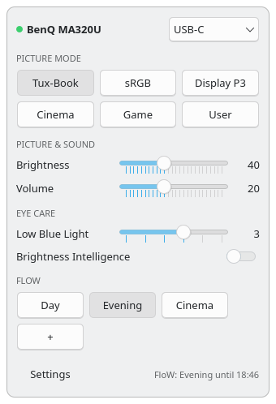
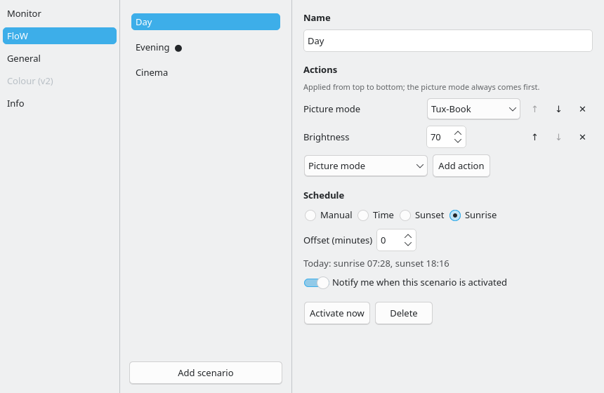

# benq-monitor-control

A Linux tray app that controls the **BenQ MA320U** monitor over DDC/CI: picture modes,
brightness, volume, input, Low Blue Light, Brightness Intelligence, and FloW scenarios
(named setting sets with an optional schedule, including local sunrise/sunset).

BenQ's own *Display Pilot 2* ships a Linux build, but its model plugin for the MA series
is not offered for Linux (`monitor does not support: "MA320U"`). The MA320U's on-screen
menu only exposes brightness, input and volume; picture modes and the other settings are
reachable via DDC/CI only. This project provides that control on Linux.

Status: v0.1.0 — tray app with quick panel, settings window and FloW scenarios.
Tested on one MA320U (USB-C) with KDE Plasma 6 on Wayland (CachyOS).

  
  

Screenshots are rendered with a simulated monitor: `.venv/bin/python tools/screenshots.py`.

## Features

- **Quick panel** at the tray: picture mode (Tux-Book, sRGB, Display P3, Cinema, Game,
  User), brightness, volume, input source (with confirmation), Low Blue Light,
  Brightness Intelligence, FloW scenario chips.
- **Per-mode locks:** controls the monitor refuses in the current picture mode are
  greyed out (e.g. Low Blue Light in sRGB and Display P3); refused writes snap back.
- **FloW scenarios:** ordered actions (picture mode first), schedule by time, sunrise or
  sunset (computed offline from your coordinates), optional notification, re-applied
  after login and resume. Can also open an application.
- **KDE Night Light hint** when Night Light and the monitor's Low Blue Light would add up.
- English and German UI, autostart, local-only (no account, no network, no telemetry).

## Requirements

- KDE Plasma 6 on **Wayland** (X11 is not supported).
- `ddcutil` with read/write access to `/dev/i2c-*` (ddcutil's udev rule or the `i2c` group).
- `pyside6`, `layer-shell-qt`, `glib2` (for `gio`).
- A BenQ **MA320U**. Other monitors are not supported yet; the model description in
  `src/benq_monitor_control/models/` is data, so further models can be added.

## Install (Arch / CachyOS)

    cd packaging && makepkg -si

Start “BenQ Monitor Control” from the launcher; enable autostart under
Settings › General. The quick panel opens at the corner of the Plasma panel that holds
the system tray (configurable under Settings › General).

## Safety

The app writes only six VCP codes — picture mode (0xDC), brightness (0x10), volume
(0x62), input (0x60), Low Blue Light (0x19), Brightness Intelligence (0x81) — and checks
every write by reading it back. Manufacturer-specific codes whose meaning is unknown are
never written. Settings are stored in the monitor exactly as if changed by BenQ's own
software. Use at your own risk; see the licence.

## How it was built

The VCP map was derived for interoperability from the publicly downloadable Display
Pilot 2 packages (strings, embedded Qt resources and disassembly of DDC call sites) and
from live tests on the monitor. **No BenQ code, binaries or resources are included.**

| Control | VCP | Values |
|---|---|---|
| Picture mode | 0xDC | 0x0F Tux-Book (M-Book), 0x0A sRGB, 0x22 Display P3, 0x32 Cinema, 0x28 Game, 0x12 User; 0x23/0x27 HDR (read-only) |
| Brightness | 0x10 | 0–100 |
| Volume | 0x62 | 0–50 |
| Input | 0x60 | 0x0F DisplayPort, 0x11 HDMI 1, 0x12 HDMI 2, 0x13 USB-C |
| Low Blue Light | 0x19 | 0 off, 1–5 (locked in sRGB and Display P3) |
| Brightness Intelligence | 0x81 | 0 off, 1 on |

0x19, 0x5F and 0x81 need `ddcutil --permit-unknown-feature`.

| Path | Content |
|---|---|
| [`src/benq_monitor_control/models/ma320u.py`](src/benq_monitor_control/models/ma320u.py) | The MA320U description the app uses (codes, labels, locks). |
| [`tools/research/`](tools/research/README.md) | Scripts used for the static analysis and the live tests. |
| [`tests/fixtures/ddcutil-2026-10-13/`](tests/fixtures/ddcutil-2026-10-13/README.md) | Real ddcutil output from the live tests. |
| [`tests/hardware/`](tests/hardware/test_ma320u_live.py) | Live round-trip check that found the per-mode locks. |

## Development

    python -m venv --system-site-packages .venv
    .venv/bin/pip install -e '.[dev]'
    .venv/bin/pytest                      # unit tests, no hardware needed
    .venv/bin/pytest -m hardware -s       # live round-trip, monitor on this computer's input
    .venv/bin/benq-monitor-control

Logs: `~/.local/state/benq-monitor-control/app.log` · Config: `~/.config/benq-monitor-control/`

## Trademarks

Not affiliated with, endorsed or sponsored by BenQ. BenQ, MA320U, Display Pilot, FloW
and Brightness Intelligence are trademarks of BenQ Corporation, used here only to
describe compatibility. “Tux-Book” is this app's name for the monitor's M-Book mode.

## License

MIT — see [LICENSE](LICENSE).
